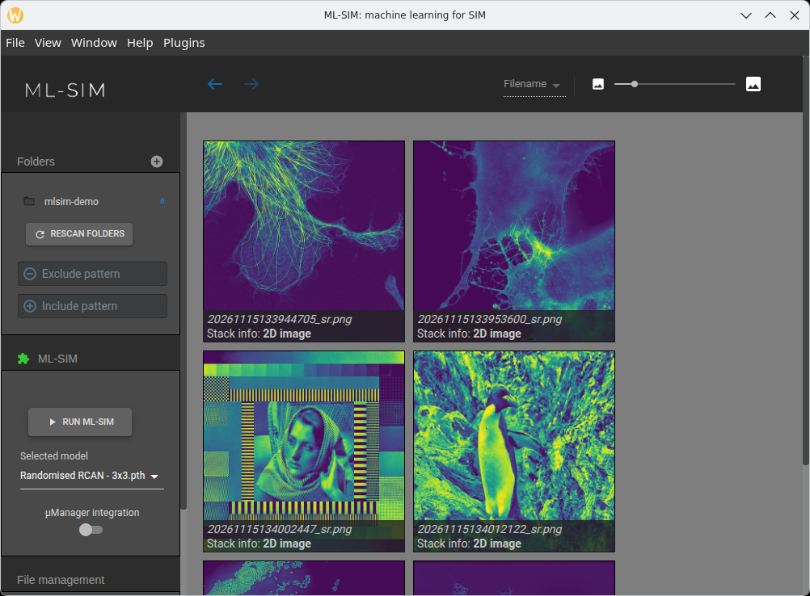

# ML-SIM desktop app

A desktop interface for running ML-SIM on folders of SIM stacks. It shows the stacks in a folder as thumbnails, reconstructs the ones you select with the pre-trained model, and displays the results next to each other. The interface is an Electron app. The reconstruction runs in a Python process that the app starts and talks to over a local socket.

<p align="center">
  
</p>

## Requirements

- Node.js 22.12 or newer
- Python 3.10 or newer (tested with 3.11)
- About 6 GB of disk space for PyTorch and the other Python packages

A GPU is optional. The engine uses CUDA when PyTorch finds it, and takes about 10 s per stack on a desktop CPU.

## Install and run

```bash
cd Graphical-App
npm install
npm run setup-engine
npm run app
```

`npm run setup-engine` creates a virtual environment in `pyengine/.venv` and installs the packages from `pyengine/requirements.txt` into it. To use an existing Python environment, skip that step and set `MLSIM_PYTHON` to its interpreter.

The first launch downloads the models (84 MB) from the [v1.0 release](https://github.com/charlesnchr/ML-SIM/releases/tag/v1.0) and checks their SHA-256. `npm run download-models` does the same without starting the app.

## Use

1. Press the plus next to Folders and choose a folder with TIFF stacks. `../Test_data` works. The ML-SIM model expects at least nine frames per stack, three orientations with three phase shifts each.
2. Right-click images to select them, or drag with the right button held. A left click opens an image in its own window.
3. Press Run ML-SIM. It processes the selection, or every image in the library if nothing is selected.
4. The results replace the library view. The arrows in the header switch between the two.

Each reconstruction is written to the export folder, which is `Documents/Mambio` unless you change it under File, Settings. Per stack you get the reconstruction as a 32-bit TIFF and an 8-bit PNG, plus colour-mapped PNGs of the reconstruction (`_sr`) and the wide-field image (`_wf`).

The Plugins menu switches the side panel to ERnet, which segments endoplasmic reticulum images into tubules and sheets. [ERnet-v2](https://github.com/charlesnchr/ERnet-v2) is the maintained version of that method.

## Develop

`npm start` runs the Vite dev server and Electron together, with hot reload for the interface.

| Path | Contents |
| --- | --- |
| `electron/` | Main process: windows, model download, starting the engine and relaying messages to it |
| `src/` | The React interface |
| `pyengine/pysrc/` | The Python engine: `engine.py` is the socket server, `mlsim_lib.py` runs the model |
| `scripts/` | `setup-engine` and `download-models` |

The engine also runs on its own with `python engine.py <port>` from `pyengine/pysrc`. The app logs the engine's output under the `[engine]` prefix, in the terminal and in the electron-log file.

`npm run dist` packages the app with electron-builder. The package contains the engine source but not Python, so the target machine needs a Python environment with the packages from `requirements.txt`, selected with `MLSIM_PYTHON`.

## Status

Version 2.0 moved the app from Electron 6 and Create React App to Electron 45 and Vite, and replaced the downloaded Windows engine binary with the Python source in this folder. It was tested on Linux with PyTorch 2.15 on CPU, both from source and as an unpacked electron-builder package. Windows and macOS have not been tested since that change.

- The interface still uses React 17, Material UI 4 and Blueprint 3.
- The μManager switch starts a socket server for a live reconstruction view during acquisition. It has not been tested since the update.
- The model menus list one model each. To use your own, replace the file in `pyengine/models` and the options in `mlsim_lib.py`.
