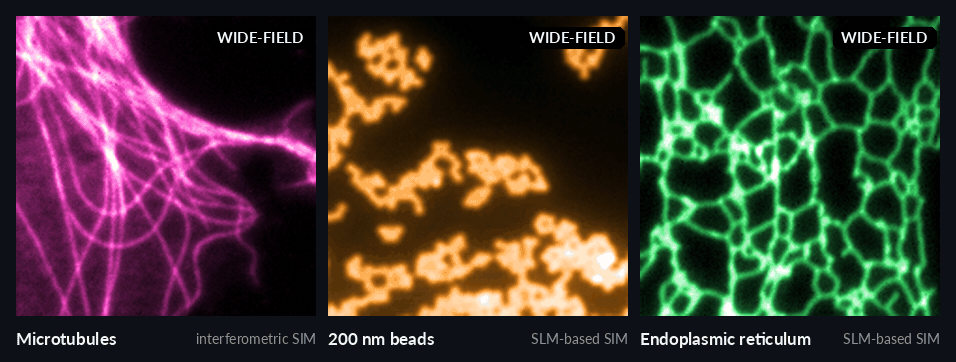
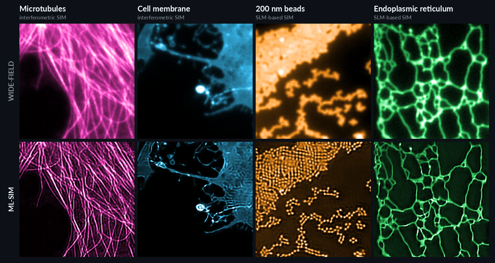
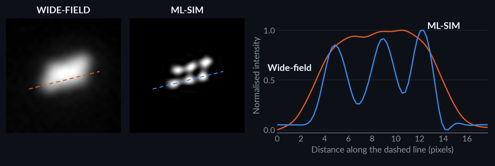
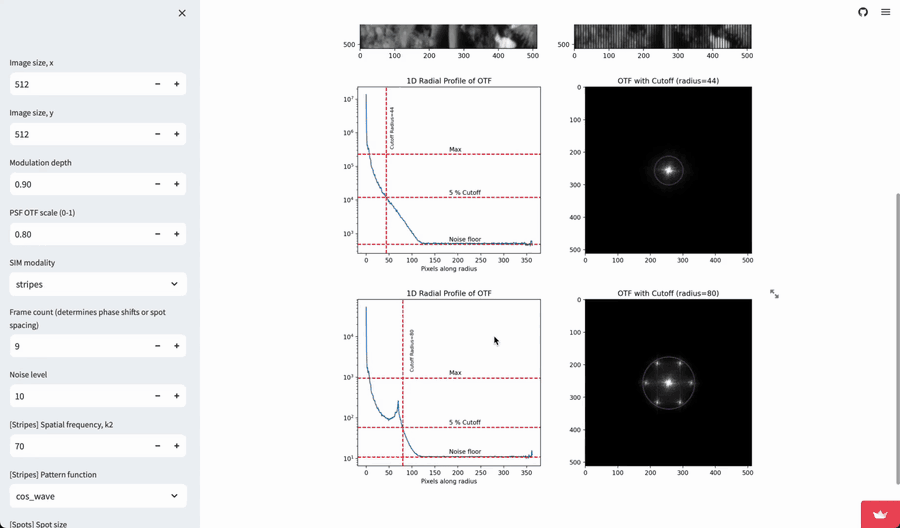

<h1 align="center">ML-SIM</h1>

<p align="center">
  <b>Super-resolution microscopy reconstruction, learned from simulation alone.</b><br>
  One forward pass turns nine raw SIM frames into a super-resolved image.<br>
  Nothing to tune, and no microscope data needed for training.
</p>

<p align="center">
  <a href="https://doi.org/10.1364/BOE.414680"></a>
  <a href="https://arxiv.org/abs/2003.11064"></a>
  <a href="https://huggingface.co/spaces/charlesnchr/ML-SIM"></a>
  <a href="https://ml-sim.streamlit.app/"></a>
  <a href="LICENSE"></a>
</p>

<p align="center">
  
</p>
<p align="center">
  <sub>Raw acquisitions from two home-built SIM microscopes, reconstructed with the model in this repository. Run <code>python reconstruct.py Test_data/*.tif</code> to reproduce them.</sub>
</p>

ML-SIM has never seen a microscope image. It learned from photographs of tigers, forests and football crowds, each one passed through a simulation of a structured illumination microscope. The same weights then reconstruct real data from microscopes the model was never fitted to, with no fine-tuning.

Structured illumination microscopy (SIM) doubles the resolution of a fluorescence microscope at speeds that suit live cells. The weak point is the reconstruction. Classical algorithms first estimate the illumination pattern from the data and then unmix it in Fourier space. When that estimate is off, because the sample is dim or the phase steps drifted, the output fills with honeycomb and ringing artefacts, or the algorithm fails outright. ML-SIM replaces the whole procedure with a neural network.

- **No experimental training data.** The training set is generated from the [DIV2K](https://data.vision.ee.ethz.ch/cvl/DIV2K/) photo collection with randomised stripe frequency, phase, modulation depth, blur and noise. You never have to acquire paired ground truth.
- **Nothing to tune.** In our comparison FairSIM, OpenSIM and CC-SIM each needed a hand-tuned configuration per dataset. ML-SIM has no settings.
- **Fast.** Under 200 ms per reconstruction on a GTX 1080 Ti, more than ten times faster than the classical methods and quick enough for a live view during acquisition. About 10 s on an 8-core CPU.
- **Robust to noise and irregular patterns.** It reconstructed interferometric SIM data with uneven phase steps that two of the three classical methods could not process. At high noise FairSIM and CC-SIM scored below the unprocessed wide-field image, while ML-SIM kept improving on it.
- **Includes a SIM simulator.** [`MLSIM_datagen/`](#a-python-port-of-the-opensim-simulator) is a Python port of the OpenSIM image formation model, extended with randomised pattern errors, Poisson noise and spot illumination. It runs on its own to make test data with a known ground truth.
- **Peer reviewed.** Published in [Biomedical Optics Express](https://doi.org/10.1364/BOE.414680) and cited more than 90 times.

## Try it

```bash
git clone https://github.com/charlesnchr/ML-SIM && cd ML-SIM
pip install torch torchvision scikit-image
python reconstruct.py Test_data/*.tif
```

The first run downloads the pre-trained weights (64 MB). Each stack in `Test_data` gets a wide-field image and an ML-SIM reconstruction in `reconstructions/`. A GPU is used when one is available.

To run it on your own data, pass TIFF stacks whose first nine frames are the raw acquisition, three pattern orientations with three phase shifts each. The released model was trained on 512x512 frames.

There are two hosted demos if you would rather not install anything.

- [Reconstruction demo on Hugging Face](https://huggingface.co/spaces/charlesnchr/ML-SIM). Upload a stack or pick one of the examples.
- [SIM simulator on Streamlit](https://ml-sim.streamlit.app/). Explore the image formation model that produces the training data.

## Results

All four samples below are real acquisitions that the model never trained on. The beads and the endoplasmic reticulum come from a microscope that generates its pattern with a spatial light modulator. The microtubules and the cell membrane come from an interferometric SIM, where a scanning mirror sets the phase and the phase steps are uneven.

<p align="center">
  
</p>

A cluster of 200 nm beads shows the gain in resolution. Wide-field imaging merges the cluster into one blob. ML-SIM separates the six beads, and a line through three of them shows three distinct peaks.

<p align="center">
  
</p>

On simulated test sets, where the ground truth is known, ML-SIM scores about 2 dB above the best classical method. The classical methods were tuned for their best achievable output on these images.

| Method | DIV2K test, PSNR (dB) | DIV2K test, SSIM | Kodak 24, PSNR (dB) | Kodak 24, SSIM |
| --- | :---: | :---: | :---: | :---: |
| Wide-field | 25.31 | 0.84 | 24.05 | 0.85 |
| CC-SIM | 25.37 | 0.89 | 24.61 | 0.86 |
| FairSIM | 25.34 | 0.86 | 25.32 | 0.86 |
| OpenSIM | 28.46 | 0.91 | 27.36 | 0.92 |
| **ML-SIM** | **30.30** | **0.95** | **30.22** | **0.96** |

<sub>From Table 1 of the <a href="https://arxiv.org/abs/2003.11064">preprint</a>. The <a href="https://doi.org/10.1364/BOE.414680">paper</a> also covers the noise sweep, the timing benchmark and a comparison with FairSIM on microtubules separated by about 150 nm.</sub>

## How it works

A SIM microscope lights the sample with a striped pattern and records nine frames, three stripe orientations with three phase shifts each. The stripes beat against fine detail in the sample and shift it down to frequencies the lens can pass, the same way two fine meshes laid over each other produce a coarse moiré. Reconstruction means recovering that detail from the nine frames.

ML-SIM learns the inversion from examples. Every training example starts as an ordinary photograph, which serves as the ground truth. A simulation of the SIM imaging process turns it into a nine-frame raw stack with random pattern parameters, optical blur and noise. A residual channel attention network ([RCAN](https://github.com/yulunzhang/RCAN) without the upsampling stage, 5.4 million parameters) takes the nine frames as input channels and learns to return the photograph.

<p align="center">
  
</p>

Because the randomisation covers a wide range of imaging conditions, the trained network copes with real microscopes without modification. The loss is the mean squared error against the ground truth. There is no adversarial term that rewards the network for inventing plausible texture.

## A Python port of the OpenSIM simulator

The training data comes from `MLSIM_datagen/`, a Python port of the SIM image formation model in [OpenSIM](https://github.com/LanMai/OpenSIM), which is written in Matlab. The port is written with NumPy and SciPy. It works on its own when all you need is simulated SIM data, for instance to test a reconstruction algorithm against a known ground truth.

Given any image, it computes the optical transfer function, multiplies the image by the illumination pattern, blurs the result and adds noise. The port adds what the training needs.

- Any number of pattern orientations and phase shifts.
- Random errors in the phase steps, the orientation and the frequency of the pattern, so that no two stacks share the same illumination.
- Gaussian or Poisson noise.
- Spot illumination in place of stripes, with `--SIMmodality spots`.

After `pip install -r requirements.txt`, one command writes a folder of stacks without training anything.

```bash
python MLSIM_pipeline.py --sourceimages_path MLSIM_datagen/DIV2K_subset --out sim_out --root auto \
    --dataonly --imageSize 512 --scale 1 --Nangles 3 --Nshifts 3 --ntrain 10 --ntest 0
```

Each TIFF in `sim_out/SIMdata` holds the raw frames, then the optical transfer function, then the ground truth. Ten 512x512 stacks take about 10 s on a desktop CPU. The stacks are valid input for `reconstruct.py`.

The Streamlit app runs the same code interactively. It shows what a set of optical parameters does to the raw frames and to the frequency support of the reconstruction, and it adds square-wave stripes to the choice of patterns. It is [hosted here](https://ml-sim.streamlit.app/) and runs locally.

```bash
streamlit run MLSIM_datagen/streamlit_frequency_support.py
```

<p align="center">
  
</p>

Only the simulation side of OpenSIM is ported. Its reconstruction algorithm is one of the baselines in the paper and is not part of this repository.

## Train a model for your own microscope

The released model expects 3x3 frames. If your system uses a different number of orientations or phase shifts, another wavelength or numerical aperture, or spot illumination, set the simulation to match and train your own. One command generates the dataset and trains the network.

```bash
python MLSIM_pipeline.py --sourceimages_path SRC_IMAGES --out ~/model_out --root auto \
    --task simin_gtout --dataset fouriersim --norm minmax \
    --imageSize 512 --Nangle 3 --Nshift 3 --nch_in 9 --nch_out 1 --scale 1 \
    --ntrain 780 --ntest 20 --nrep 1 --datagen_workers 4 \
    --model rcan --n_resgroups 2 --n_resblocks 5 --n_feats 48 \
    --lr 0.0001 --nepoch 50 --scheduler 10,0.5 --batchSize 5 --workers 0 \
    --saveinterval 20 --plotinterval 10 --nplot 5
```

`SRC_IMAGES` is a folder of varied images such as [DIV2K](http://data.vision.ee.ethz.ch/cvl/DIV2K/DIV2K_train_HR.zip), which the paper used, or ImageNet. The released model uses a larger network, `--n_resgroups 3 --n_resblocks 10 --n_feats 96`. Training needs a CUDA GPU and the full set of packages from `pip install -r requirements.txt`. Add `--disable_wandb` to skip logging to Weights & Biases, and run `python MLSIM_pipeline.py -h` for every option.

Before you spend GPU hours, check your optical parameters in the [Streamlit app](#a-python-port-of-the-opensim-simulator).

## What is in the repository

| Path | Contents |
| --- | --- |
| `reconstruct.py` | Reconstruct TIFF stacks with the pre-trained model |
| `MLSIM_pipeline.py` | Dataset generation and training in one command |
| `MLSIM_datagen/` | A Python port of the [OpenSIM](https://github.com/LanMai/OpenSIM) simulator, with the extensions used for training, and the Streamlit app |
| `models.py`, `run.py`, `datahandler.py`, `options.py` | Network architectures, training loop, data loading and command line options |
| `1_PrepareTrainingData.ipynb`, `2_Train.ipynb`, `3_Evaluate.ipynb` | The same pipeline as step by step notebooks |
| `Test_data/` | Raw stacks from two microscopes and two simulated test targets |
| `Graphical-App/` | A desktop app for browsing folders of stacks and reconstructing them in batches, with its own [README](Graphical-App) |
| `fig/make_figures.py` | Regenerates the figures on this page from `Test_data` |

The pre-trained weights are also available as a [direct download](https://github.com/charlesnchr/ML-SIM/releases/download/v1.0/DIV2K_randomised_3x3_20200317.pth).

## Limits

- The released model handles 2D SIM with nine frames. Other acquisition schemes need a retrained model, and 3D SIM is not supported.
- The simulation does not model out-of-focus light. Thick samples with dense background above or below the focal plane can produce artefacts, as they do with classical reconstruction.
- A network can only be trusted within the conditions it was trained for. For quantitative work on a new kind of sample, check a few reconstructions against a classical method first.

## Citation

```bibtex
@article{christensen2021mlsim,
  title   = {ML-SIM: universal reconstruction of structured illumination microscopy images using transfer learning},
  author  = {Christensen, Charles N. and Ward, Edward N. and Lu, Meng and Lio, Pietro and Kaminski, Clemens F.},
  journal = {Biomedical Optics Express},
  volume  = {12},
  number  = {5},
  pages   = {2720--2733},
  year    = {2021},
  doi     = {10.1364/BOE.414680}
}
```

ML-SIM was developed in the [Laser Analytics Group](https://laser.ceb.cam.ac.uk/) and the Artificial Intelligence Group at the University of Cambridge by Charles N. Christensen, Edward N. Ward, Meng Lu, Pietro Lio and Clemens F. Kaminski. Questions about the code go to Charles, through the [issue tracker](https://github.com/charlesnchr/ML-SIM/issues) or at `charles.n.chr@gmail.com`.

## Related work

- [VSR-SIM](https://github.com/charlesnchr/VSR-SIM) extends the idea to video, with a transformer that reconstructs SIM sequences of moving samples.
- [ERnet](https://github.com/charlesnchr/ERnet-v2) segments and analyses the endoplasmic reticulum in images like the ones above.

## License

The code and the pre-trained weights are released under the [GNU General Public License v3.0](LICENSE). You can use, modify and redistribute them, and derived work that you distribute has to stay under the same license.

## Credits

- [OpenSIM](https://github.com/LanMai/OpenSIM) for the Matlab image formation model that the simulation is based on.
- [RCAN](https://github.com/yulunzhang/RCAN) for the network architecture.
- [DIV2K](https://data.vision.ee.ethz.ch/cvl/DIV2K/) for the training images.
