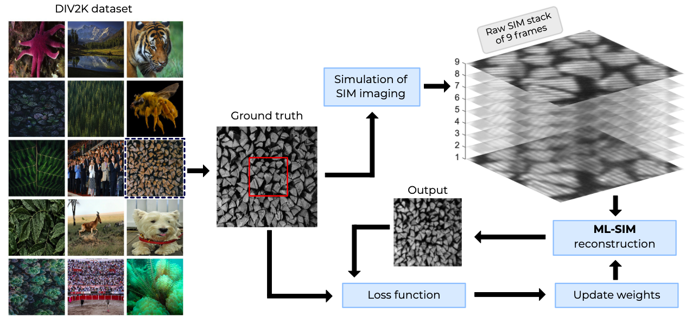

<h1 align="center">ML-SIM</h1>

<p align="center">
  <b>Super-resolution microscopy reconstruction, learned from simulation alone.</b><br>
  One forward pass turns nine raw SIM frames into a super-resolved image.<br>
  Nothing to tune, and no microscope data needed for training.
</p>

<p align="center">
  <a href="https://doi.org/10.1364/BOE.414680"></a>
  <a href="https://arxiv.org/abs/2003.11064"></a>
  <a href="https://huggingface.co/spaces/charlesnchr/ML-SIM"></a>
  <a href="https://ml-sim.streamlit.app/"></a>
  <a href="LICENSE"></a>
</p>

<p align="center">
  
</p>
<p align="center">
  <sub>Raw acquisitions from two home-built SIM microscopes, reconstructed with the model in this repository. Run <code>python reconstruct.py Test_data/*.tif</code> to reproduce them.</sub>
</p>

ML-SIM has never seen a microscope image. It learned from photographs of tigers, forests and football crowds, each one passed through a simulation of a structured illumination microscope. The same weights then reconstruct real data from microscopes the model was never fitted to, with no fine-tuning.

Structured illumination microscopy (SIM) doubles the resolution of a fluorescence microscope at speeds that suit live cells. The weak point is the reconstruction. Classical algorithms first estimate the illumination pattern from the data and then unmix it in Fourier space. When that estimate is off, because the sample is dim or the phase steps drifted, the output fills with honeycomb and ringing artefacts, or the algorithm fails outright. ML-SIM replaces the whole procedure with a neural network.

- **No experimental training data.** The training set is generated from the [DIV2K](https://data.vision.ee.ethz.ch/cvl/DIV2K/) photo collection with randomised stripe frequency, phase, modulation depth, blur and noise. You never have to acquire paired ground truth.
- **Nothing to tune.** In our comparison FairSIM, OpenSIM and CC-SIM each needed a hand-tuned configuration per dataset. ML-SIM has no settings.
- **Fast.** Under 200 ms per reconstruction on a GTX 1080 Ti, more than ten times faster than the classical methods and quick enough for a live view during acquisition. About 10 s on an 8-core CPU.
- **Robust to noise and irregular patterns.** It reconstructed interferometric SIM data with uneven phase steps that two of the three classical methods could not process. At high noise FairSIM and CC-SIM scored below the unprocessed wide-field image, while ML-SIM kept improving on it.
- **Peer reviewed.** Published in [Biomedical Optics Express](https://doi.org/10.1364/BOE.414680) and cited more than 90 times.

## Try it

```bash
git clone https://github.com/charlesnchr/ML-SIM && cd ML-SIM
pip install torch torchvision scikit-image
python reconstruct.py Test_data/*.tif
```

The first run downloads the pre-trained weights (64 MB). Each stack in `Test_data` gets a wide-field image and an ML-SIM reconstruction in `reconstructions/`. A GPU is used when one is available.

To run it on your own data, pass TIFF stacks whose first nine frames are the raw acquisition, three pattern orientations with three phase shifts each. The released model was trained on 512x512 frames.

There are two hosted demos if you would rather not install anything.

- [Reconstruction demo on Hugging Face](https://huggingface.co/spaces/charlesnchr/ML-SIM). Upload a stack or pick one of the examples.
- [SIM simulator on Streamlit](https://ml-sim.streamlit.app/). Explore the image formation model that produces the training data.

## Results

All four samples below are real acquisitions that the model never trained on. The beads and the endoplasmic reticulum come from a microscope that generates its pattern with a spatial light modulator. The microtubules and the cell membrane come from an interferometric SIM, where a scanning mirror sets the phase and the phase steps are uneven.

<p align="center">
  
</p>

A cluster of 200 nm beads shows the gain in resolution. Wide-field imaging merges the cluster into one blob. ML-SIM separates the six beads, and a line through three of them shows three distinct peaks.

<p align="center">
  
</p>

On simulated test sets, where the ground truth is known, ML-SIM scores about 2 dB above the best classical method. The classical methods were tuned for their best achievable output on these images.

| Method | DIV2K test, PSNR (dB) | DIV2K test, SSIM | Kodak 24, PSNR (dB) | Kodak 24, SSIM |
| --- | :---: | :---: | :---: | :---: |
| Wide-field | 25.31 | 0.84 | 24.05 | 0.85 |
| CC-SIM | 25.37 | 0.89 | 24.61 | 0.86 |
| FairSIM | 25.34 | 0.86 | 25.32 | 0.86 |
| OpenSIM | 28.46 | 0.91 | 27.36 | 0.92 |
| **ML-SIM** | **30.30** | **0.95** | **30.22** | **0.96** |

<sub>From Table 1 of the <a href="https://arxiv.org/abs/2003.11064">preprint</a>. The <a href="https://doi.org/10.1364/BOE.414680">paper</a> also covers the noise sweep, the timing benchmark and a comparison with FairSIM on microtubules separated by about 150 nm.</sub>

## Update – July 2023: Interactive Streamlit Application

Announcing a new app in the ML-SIM project: the integration of an interactive Streamlit application for exploring training data with the image formation model that forms the foundation of the training data in ML-SIM. This enables the exploration of the optical parameters relevant to SIM and can provide insight into achievable resolution improvement based on simulated frequency support (OTF area). The app makes it easier to fine-tune and choose parameters before training a custom ML-SIM model.

Access the Streamlit application here:

[](https://ml-sim.streamlit.app/)

To play with the Streamlit application locally, execute the following command:

```bash
streamlit run MLSIM_datagen/streamlit_frequency_support.py
```

Below is a preview of the interactive Streamlit application:


## How it works
ML-SIM uses synthetic training data that is simulated based on an physically accurate implementation of the SIM (structured illumination microscopy) imaging process. A deep neural network is trained to solve the inverse problem and with transfer learning it is possible to make the trained model work well on experimental data from the lab.



## Layout of repository
- Python scripts for dataset generation, training and testing.
  - The entire pipeline can be started with for example
    ```python
    python MLSIM_pipeline.py --sourceimages_path SRC_IMAGES --out ~/model_out \
    --ntrain 20 --ntest 20 --root auto --task simin_gtout --imageSize 512 --nrep 1 \
    --datagen_workers 4 --model rcan --nch_in 9 --nch_out 1 --ntrain 780 --ntest 20 \
    --scale 1 --task simin_gtout --n_resgroups 2 --n_resblocks 5 --n_feats 48 --lr 0.0001 \
    --nepoch 50 --scheduler 10,0.5 --norm minmax --dataset fouriersim --workers 0 \
    --batchSize 5 --saveinterval 20 --plotinterval 10 --nplot 5 --Nangle 3 --Nshift 3
    ```
    where `SRC_IMAGES` are diverse images from ImageNet, [DIV2K](https://data.vision.ee.ethz.ch/cvl/DIV2K/) (used in publication) or similar image sets. To see all options run `python MLSIM_pipeline.py -h` or see the source code.
- Jupyter notebooks for dataset generation, training and testing.
  - _1_PrepareTrainingData_: Simulates the SIM imaging process in order to generate SIM images based on clean source images. This constitutes the training data.
  - _2_Train_: Training
- [Graphical-App](https://github.com/charlesnchr/ML-SIM/tree/master/Graphical-App) (see animation above). A graphical desktop app to use trained ML-SIM models on SIM data based on the Electron framework.
  - More information in separate README in the sub-folder of this repository: [README.md](https://github.com/charlesnchr/ML-SIM/tree/master/Graphical-App)


## Resources
- Pre-trained model for 3x3 SIM images at 512x512 pixel resolution. [Download link](https://github.com/charlesnchr/ML-SIM/releases/download/v1.0/DIV2K_randomised_3x3_20200317.pth). See the notebook `3_Evaluate.ipynb` for how to run this pre-trained model.
- DIV2K source image set used for dataset generation for ML-SIM. [Download link](http://data.vision.ee.ethz.ch/cvl/DIV2K/DIV2K_train_HR.zip).


## Graphical desktop app
An easy to install and use desktop app for Windows 10, macOS and Linux is available as an Electron app. Instructions and all source code to run the app is given in the sub folder [Graphical-App](https://github.com/charlesnchr/ML-SIM/tree/master/Graphical-App). The program allows one to batch process a set of directories including subdirectories that contain TIFF stacks, and customise and select the model that is used for reconstruction. See screenshot below.


## Credits
- OpenSIM (Matlab code) [https://github.com/LanMai/OpenSIM](https://github.com/LanMai/OpenSIM)
- RCAN (Pytorch model) [https://github.com/yulunzhang/RCAN](https://github.com/yulunzhang/RCAN)
